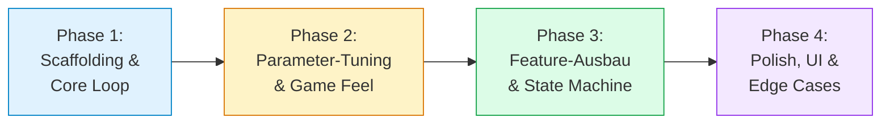

# Neon Dodge (Babylon.js & TypeScript)

> **Agentic Game Development Showcase** zur Vorlesung *Interaktive Grafikanwendungen (IGA)*  
> Prof. Dr. Robin Nunkesser – Hochschule Hamm-Lippstadt (HSHL)  
> 🎮 **Live Demo:** [https://robinnunkesser.github.io/ts-neondodge-babylonjs/](https://robinnunkesser.github.io/ts-neondodge-babylonjs/)

[](https://github.com/RobinNunkesser/ts-neondodge-babylonjs/actions/workflows/deploy.yml)

Dieses Repository dient als didaktische Referenzimplementierung und Aufgaben-Template für das Thema **Spec-Driven Game Development** mit KI-Agenten (z. B. Google Antigravity, GitHub Copilot, Cursor, Claude Code).

---

## 🎯 Didaktisches Ziel: Intent-Engineering statt Vibe Coding

Statt einer KI vage Anweisungen zuzurufen (*„Programmier mir ein cooles 3D-Spiel“*), steuern die Studierenden die Entwicklung als **Game Director & Lead Architect** über ein modulares, softwaretechnisch präzises **Micro Game Design Document (Micro-GDD)**.

### Das Micro-GDD in `docs/gdd/`

Die Spezifikation ist in fünf klar abgegrenzte Markdown-Module unterteilt:

1. [**01_concept_and_loop.md**](docs/gdd/01_concept_and_loop.md): High Concept, 5–10-Sekunden Core Loop, Win/Loss-Bedingungen und Score-Modell.
2. [**02_input_and_controls.md**](docs/gdd/02_input_and_controls.md): Desktop- & Touch-Steuerung, Kinematik, Damping/Lerp und Kamerasicht.
3. [**03_architecture.md**](docs/gdd/03_architecture.md): Softwarearchitektur (Strikte Trennung von Headless-Logik `src/core/` und Engine-Rendering `src/render/`).
4. [**04_state_machine.md**](docs/gdd/04_state_machine.md): Formales Zustandsdiagramm (`MENU`, `PLAYING`, `PAUSED`, `GAME_OVER`) und Lebenszyklus.
5. [**05_parameters.md**](docs/gdd/05_parameters.md): Zentraler Parameter-Katalog für `src/config.ts` (Tuning ohne Code-Risiko).

---

## 🔄 Der 4-Phasen-Workflow

Die Entwicklung erfolgt diszipliniert in 4 inkrementellen Phasen. **Nach jeder Phase wird im Browser getestet und ein Git-Commit erstellt.**



### Typische Prompts pro Phase

* **Phase 1 (Scaffolding):**
  > *„Lies `docs/gdd/01_concept_and_loop.md` und `docs/gdd/03_architecture.md`. Erstelle das Grundgerüst mit Vite, TypeScript und Babylon.js. Implementiere nur den minimalen Core Loop: Gleiter weicht Hindernissen auf dem Highway aus.“*

* **Phase 2 (Parameter-Tuning):**
  > *„Lies `docs/gdd/05_parameters.md`. Übertrage alle Konstanten vollständig nach `src/config.ts` und refaktoriere den bestehenden Code so, dass keine Magic Numbers mehr verwendet werden.“*

* **Phase 3 (State Machine):**
  > *„Lies `docs/gdd/04_state_machine.md`. Implementiere den Zustandsautomaten mit Startbildschirm, Pause und Game-Over-Screen. Schreibe automatisierte Unit-Tests für `src/core/state.ts` mit Vitest.“*

* **Phase 4 (Juice & Polish):**
  > *„Lies `docs/gdd/02_input_and_controls.md` und `docs/gdd/05_parameters.md`. Ergänze Screen Shake bei Kollisionen, Banking-Rotation bei der Lenkung und Partikel-Feedback.“*

---

## 🛠️ Lokale Entwicklung

```bash
# Abhängigkeiten installieren
npm install

# Dev-Server starten (Hot Reload)
npm run dev

# Tests ausführen (Headless Unit Tests)
npm test

# Produktions-Build erstellen
npm run build
```

---

## 📜 Lizenz
MIT License – Robin Nunkesser
